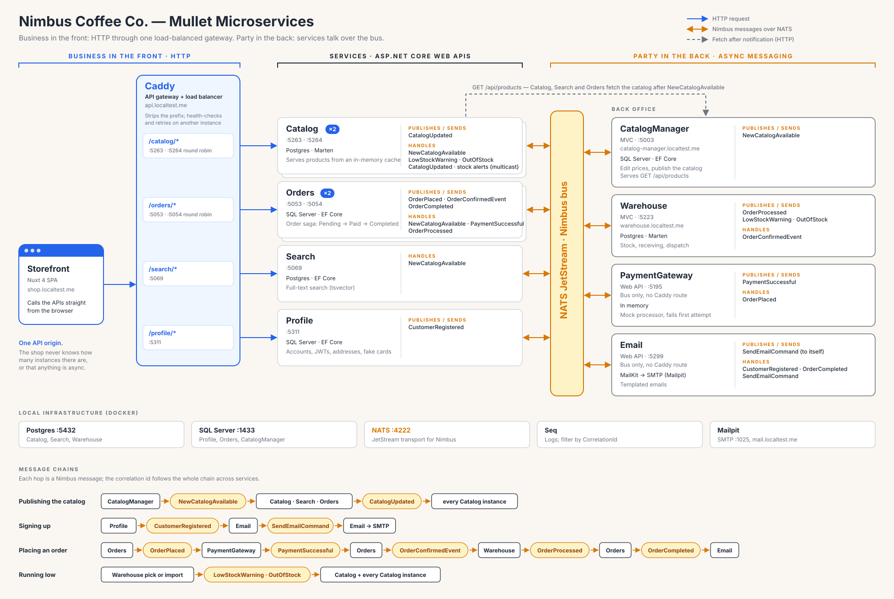

# Architecture

**Mullet microservices:** business in the front, party in the back. The storefront sees one HTTP origin, `api.localtest.me`, and Caddy routes each path prefix to a service, round robins across instances and skips unhealthy ones. Behind that, the services don't call each other over HTTP. They publish and handle Nimbus messages over NATS JetStream.

The one HTTP call between services is fetching data after a notification: CatalogManager publishes `NewCatalogAvailable`, and Catalog, Search and Orders each fetch `GET /api/products` from it.

The diagram is generated by `generate-architecture.py`. Edit the script and run `python3 docs/generate-architecture.py` rather than editing the SVG by hand.

`architecture-slide.svg` (and a 3840×2160 `architecture-slide.png`) is a simpler 16:9 version for slides, without the message details, infrastructure or title. It's generated by `generate-architecture-slide.py`; re-export the PNG after changing it.

`saga-slide.svg` (and a 3840×1920 `saga-slide.png`) shows the order saga as swimlanes: Orders moves `Pending → Paid → Completed` as PaymentGateway, Warehouse and Email handle each step's message. It's 2:1 so it fits under a slide title. It's generated by `generate-saga-slide.py`; re-export the PNG after changing it.
